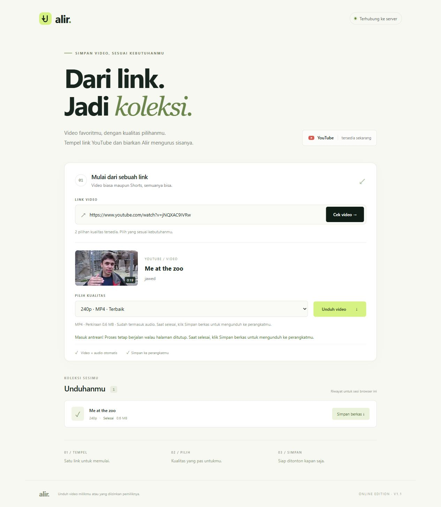

# Alir — Video Downloader

Aplikasi sederhana untuk mengunduh satu video YouTube atau Shorts dengan pilihan kualitas yang tersedia. Bisa digunakan **lokal**, atau dengan **frontend/gateway di Vercel + worker Docker di server**. Dibangun dengan Python, FastAPI, yt-dlp, dan SQLite.

**Mau import ke Vercel?** Ikuti [panduan Vercel + Docker](docs/deployment.md). Vercel menjalankan `index.py`; worker mengunduh dan menggabungkan video di luar function Vercel. Tidak ada batas durasi video atau ukuran berkas yang ditetapkan aplikasi. Backend tetap membutuhkan disk dan bandwidth yang cukup, serta akses YouTube yang diizinkan.



## Menjalankan di Windows

Prasyarat: **Python 3.11+** dan **Node.js 22+** (atau Deno 2+), tersedia di PATH. Node.js hanya digunakan oleh yt-dlp untuk memproses tantangan JavaScript YouTube. Tidak perlu npm install. FFmpeg sudah disertakan melalui paket `imageio-ffmpeg`; tidak perlu memasangnya secara manual.

**Klik dua kali `start.bat`**, lalu buka <http://127.0.0.1:8000>. Peluncur membuat virtual environment dan memasang dependensi jika belum tersedia. Pertama kali perlu internet untuk instalasi.

Atau dari PowerShell:

```powershell
python -m venv .venv
.\.venv\Scripts\python.exe -m pip install -r requirements-worker.txt
.\.venv\Scripts\python.exe run.py
```

Jika port 8000 sudah dipakai:

```powershell
.\.venv\Scripts\python.exe run.py --port 8001
```

## Penggunaan

1. Tempel link video YouTube, `youtu.be`, atau Shorts.
2. Tekan **Cek video** untuk mengambil judul, thumbnail, dan kualitas yang tersedia.
3. Pilih resolusi, lalu tekan **Unduh video**.
4. Progres tampil di **Unduhanmu**. Satu unduhan dikerjakan pada satu waktu, maksimal 20 dalam antrean.
5. Hasil otomatis tersimpan di `downloads/<id-unduhan>/`. Tombol **Simpan berkas** juga dapat menyimpan salinan lewat browser.

Audio disertakan otomatis. Video dan audio terpisah digabung dengan FFmpeg tanpa mengubah kualitas. MP4 diprioritaskan jika tersedia; format lain dapat menghasilkan WebM atau MKV sesuai codec aslinya. Resolusi tidak ditingkatkan secara buatan. Ukuran dan persentase progres merupakan perkiraan; ETA berlaku untuk stream yang sedang diproses.

Riwayat tersimpan di `data/downloads.sqlite3` dan menampilkan 100 unduhan terakhir. Jangan hapus folder `data` jika ingin mempertahankan riwayat. Berkas unduhan tetap di disk sampai dihapus sendiri. Rencana unduhan disimpan di database; antrean yang terputus akan dijalankan kembali saat server dinyalakan, menggunakan berkas parsial yang masih tersedia jika yt-dlp mendukungnya. Unduhan lama dari versi 1.0 yang belum punya rencana tersimpan ditandai gagal dan harus dimulai ulang. Hentikan server dengan Ctrl+C.

Pada mode online, antrean dan berkas disimpan di volume Docker. Riwayat dipisahkan menggunakan cookie sesi browser bertanda tangan. Browser lain tidak dapat melihat atau mengambil berkas sesimu. Menghapus cookie atau mengganti browser membuat sesi baru; belum ada akun untuk menyinkronkan riwayat. Batas antrean adalah 20 secara keseluruhan dan 3 unduhan aktif per sesi online.

## Batasan

- Versi ini mendukung satu video publik per link; playlist, live yang masih berlangsung, video privat, DRM, dan konten yang mewajibkan login belum didukung.
- Hasil bergantung pada akses YouTube dari jaringanmu. YouTube bisa membatasi IP, menolak akses, atau meminta login. Aplikasi menampilkan pesan kegagalan; tidak ada mekanisme untuk melewati pembatasan tersebut.
- Pilihan kualitas berlaku 30 menit selama server yang sama masih berjalan. Periksa ulang link jika kedaluwarsa atau format berubah.
- Mode lokal berjalan di `127.0.0.1`. Untuk online gunakan gateway Vercel dan worker yang dilindungi token sesuai panduan deployment. Gunakan satu proses dan satu replica worker untuk satu volume SQLite.
- Berkas besar ditransfer langsung dari worker ke browser dengan link bertanda tangan dan dukungan HTTP Range. File tidak dikirim melalui Vercel. Disk sementara saat penggabungan perlu sekitar 2–3 kali ukuran hasil. Tidak ada penghapusan otomatis; kelola ruang penyimpanan server.
- Unduh video milikmu atau yang telah diizinkan pemiliknya.

YouTube berubah secara berkala. Jika ekstraksi mulai gagal, perbarui yt-dlp di virtual environment, lalu jalankan ulang server:

```powershell
.\.venv\Scripts\python.exe -m pip install --upgrade "yt-dlp[default]"
```

Versi awal dipatok di `requirements.txt` agar instalasi dapat direproduksi. Setelah memperbarui dan memverifikasi unduhan, sesuaikan versi di file tersebut jika ingin membagikan pembaruan. Dokumentasi resmi: [yt-dlp](https://github.com/yt-dlp/yt-dlp), [runtime JavaScript / EJS](https://github.com/yt-dlp/yt-dlp/wiki/EJS).

## Struktur & menambah sumber

```text
app/
  gateway.py              # Gateway Vercel, cookie sesi, redirect berkas langsung
  config.py               # Konfigurasi lokal/worker dari environment
  security.py             # Tanda tangan sesi dan link unduhan
  web.py                  # Halaman statis dan middleware HTTP
  main.py                 # Endpoint HTTP, validasi request, halaman statis
  service.py              # Antrean, progres, cache metadata, SQLite
  runtime.py              # Deteksi JavaScript dan FFmpeg bawaan
  providers/
    base.py               # Kontrak Provider, Video, Quality
    youtube.py            # Normalisasi link, kualitas, dan unduhan YouTube
    __init__.py           # Registrasi provider
  static/                 # Antarmuka tanpa framework frontend
tests/                    # Pengujian API, antrean, format, dan persistensi
index.py                  # Entrypoint Vercel (tanpa yt-dlp/SQLite)
Dockerfile                # Worker Python + Node.js + FFmpeg
compose.yaml              # Volume persisten dan proxy HTTPS opsional
vercel.json               # Konfigurasi import Vercel
run.py                    # Server lokal
start.bat                 # Peluncur Windows
```

Untuk menambah platform, implementasikan `normalize_url`, `inspect`, dan `download` mengikuti `Provider` di `app/providers/base.py`, lalu daftarkan di `default_providers()`. Validasi domain dan ubah link menjadi URL kanonis dalam provider. Jangan meneruskan URL sembarang ke extractor. Perbarui label sumber, teks bantuan, serta kebijakan thumbnail CSP pada antarmuka jika provider baru memerlukannya.

Endpoint utama: `POST /api/inspect`, `POST /api/downloads`, `GET /api/downloads`, `GET /api/downloads/{id}/file`, `GET /api/health`. Skema API tersedia di `/openapi.json`.

## Pengujian

```powershell
.\.venv\Scripts\python.exe -m pip install -r requirements-dev.txt
.\.venv\Scripts\python.exe -m pytest -q
node --check app/static/app.js
```

Tes memakai provider tiruan untuk memeriksa alur API → antrean → berkas → riwayat tanpa bergantung pada jaringan YouTube, serta gateway → worker → redirect berkas >4,5 MB, HTTP Range, isolasi browser, dan pemulihan antrean. Pengujian FFmpeg menggunakan berkas audio-video nyata sintetis. Pengujian unduhan YouTube sesungguhnya dilakukan terpisah karena akses dipengaruhi IP, jaringan, dan perubahan YouTube. Lihat [catatan verifikasi](docs/verification.md).
