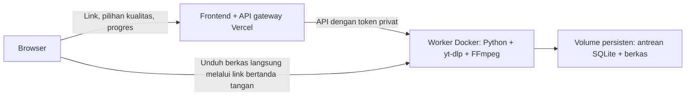

# Deploy Alir: Vercel + Docker

Repo ini menyediakan dua bagian yang dijalankan terpisah:



**Import Vercel saja menayangkan antarmuka. Fitur unduh baru aktif setelah worker dapat diakses lewat HTTPS dan dua environment variable dihubungkan.** Docker di laptop dapat digunakan untuk pengujian lokal, tetapi Vercel tidak dapat mengakses `127.0.0.1` di laptopmu. Untuk online, jalankan container pada server yang bisa diakses publik dan tetap menyala.

## Video panjang dan berkas besar

- Tidak ada batas durasi total video, total waktu pengerjaan unduhan, atau ukuran berkas yang ditetapkan aplikasi/worker.
- Request ke Vercel hanya untuk metadata, pembuatan antrean, polling, dan mengambil link. Proses unduh berjalan di worker sesudah request selesai, termasuk saat browser ditutup.
- Saat menekan **Simpan berkas**, Vercel mengembalikan redirect 303 ke link bertanda tangan pada worker. Semua byte video mengalir **worker → browser**, sehingga transfer tidak terikat batas ukuran respons atau durasi function Vercel.
- Link berlaku satu jam secara default. Validasi dilakukan saat request mulai; transfer yang sudah berjalan tidak dihentikan saat masa berlaku lewat. Jika koneksi terputus setelah link kedaluwarsa, klik **Simpan berkas** lagi untuk mendapat link baru. Link mendukung HTTP Range untuk pengambilan sebagian berkas.
- Batas nyata: kapasitas disk, bandwidth, CPU, kebijakan dan kestabilan server/container, serta ketersediaan YouTube. Tidak ada janji ukuran/durasi tak terbatas. Siapkan sekitar 2–3 kali ukuran berkas hasil saat menggabungkan audio dan video.
- Cadangan disk default worker adalah 1 GiB. Request baru ditolak jika estimasi ukuran tidak muat; proses dihentikan dengan pesan error jika ruang bebas mencapai cadangan. Set `ALIR_MIN_FREE_GB` sesuai kebutuhan. Berkas hasil tidak dihapus otomatis.
- Antrean dan pilihan format per job disimpan di SQLite pada volume. Setelah restart, job belum selesai diantrekan ulang. yt-dlp melanjutkan berkas parsial jika didukung format/server. Tidak menjamin kelanjutan tepat pada byte yang sama untuk semua protokol; penggabungan bisa diulang.

## 1. Siapkan worker Docker

Prasyarat: Docker Engine/Desktop dengan Docker Compose v2. Untuk deployment publik dibutuhkan server, domain/subdomain worker, DNS yang mengarah ke server, dan port 80/443 yang dapat diakses jika memakai proxy bawaan.

Clone repo dan buat file konfigurasi privat:

```powershell
git clone https://github.com/Rochman29/alir-downloader.git
cd alir-downloader
Copy-Item .env.worker.example .env.worker
```

Di Linux, ganti `Copy-Item` dengan `cp`. Buat token acak di komputermu:

```powershell
python -c "import secrets; print(secrets.token_urlsafe(48))"
```

Simpan token itu sebagai `ALIR_WORKER_TOKEN` di `.env.worker`. File ini diabaikan Git. Gunakan token yang sama di environment Vercel; jangan menaruhnya di JavaScript browser atau membagikannya lewat chat. Token minimal 32 karakter. Contoh konfigurasi publik dengan domain ilustrasi:

```dotenv
ALIR_WORKER_TOKEN=<token-acakmu>
ALIR_PUBLIC_WORKER_URL=https://worker.domainmu.com
ALIR_ALLOWED_HOSTS=worker.domainmu.com
ALIR_WORKER_DOMAIN=worker.domainmu.com
ALIR_BIND_ADDRESS=127.0.0.1
ALIR_PORT=8000
ALIR_MIN_FREE_GB=1
ALIR_DOWNLOAD_LINK_TTL_SECONDS=3600
```

Ganti domain ilustrasi dengan domain yang benar. Domain worker berbeda dari domain aplikasi Vercel dan harus tetap dapat diakses oleh browser.

### Pengujian Docker lokal

Untuk uji lokal, pertahankan `ALIR_PUBLIC_WORKER_URL=http://127.0.0.1:8000` dan `ALIR_ALLOWED_HOSTS=127.0.0.1,localhost` pada template, lalu:

```powershell
docker compose --env-file .env.worker up -d --build
docker compose --env-file .env.worker ps
```

`http://127.0.0.1:8000/healthz` harus memberikan `{"status":"ok"}`. Root worker hanya menampilkan status layanan, bukan antarmuka aplikasi.

Untuk menguji gateway lokal, salin `.env.vercel.example` ke `.env.gateway.local`, isi `ALIR_BACKEND_URL=http://127.0.0.1:8000` dan token yang sama, lalu jalankan:

```powershell
python -m venv .venv
.\.venv\Scripts\python.exe -m pip install -r requirements.txt
.\.venv\Scripts\python.exe -m uvicorn index:app --env-file .env.gateway.local --host 127.0.0.1 --port 8001
```

Buka `http://127.0.0.1:8001`. Konfigurasi HTTP loopback ini hanya untuk pengujian lokal.

### Worker publik dengan HTTPS

Compose menyertakan proxy Caddy opsional. Setelah DNS domain worker mengarah ke server dan `.env.worker` memakai domain publik seperti contoh di atas:

```powershell
docker compose --env-file .env.worker --profile public up -d --build
```

Caddy menerbitkan dan memperbarui sertifikat HTTPS untuk domain tersebut. Jika server sudah punya reverse proxy, jalankan tanpa profil `public`, lalu arahkan reverse proxy yang ada ke `127.0.0.1:8000`. Hindari batas waktu atau buffering penuh untuk respons berkas besar. Jangan letakkan limit transfer dari CDN lain pada domain worker jika ingin unduhan panjang langsung ke origin.

Periksa `https://worker.domainmu.com/healthz`. Endpoint API `/api/*` memerlukan token internal; error 401 jika dibuka langsung di browser adalah normal. Endpoint `/files/*` menggunakan link bertanda tangan, bukan token permanen.

## 2. Import repo ke Vercel

1. Import repo GitHub `Rochman29/alir-downloader`.
2. Gunakan root repository dan preset **FastAPI**. Entrypoint-nya `index.py`; konfigurasi sudah tersedia dalam `vercel.json`. Tidak perlu Build Command frontend.
3. Tambahkan environment variable melalui dashboard Vercel:

| Nama | Nilai |
| --- | --- |
| `ALIR_BACKEND_URL` | Origin HTTPS worker, misalnya `https://worker.domainmu.com`, tanpa path |
| `ALIR_WORKER_TOKEN` | Token privat yang sama dengan worker |

Simpan token sebagai Secret. Atur environment Production/Preview yang ingin digunakan. Jika variabel ditambahkan setelah deployment, redeploy agar variabel diterapkan. Jangan menambahkan `ALIR_MODE=worker` atau `ALIR_STORAGE_DIR` pada Vercel.

4. Deploy, lalu buka situs. Badge **Terhubung ke server** berarti gateway sudah bisa membaca status worker. Coba satu video pendek dahulu, pilih kualitas, lalu periksa tombol **Simpan berkas**.

`requirements.txt` hanya berisi dependensi gateway ringan. `requirements-worker.txt` menambahkan yt-dlp dan FFmpeg untuk mode lokal/Docker; paket berat ini tidak dipasang di Vercel. Gateway tidak membuat database atau berkas unduhan pada filesystem Vercel.

## Operasional

- Satu volume SQLite harus digunakan oleh **satu proses / satu replica worker**. Image menjalankan Uvicorn dengan satu worker. Jangan menambah `--workers` atau melakukan scale-out menggunakan volume yang sama.
- Volume `alir_storage` menyimpan `data/downloads.sqlite3` dan `downloads/<id>/`. Volume tetap tersedia saat container diganti atau di-restart. `docker compose down -v` menghapus volume dan data, jadi gunakan `down` biasa untuk menghentikan layanan.
- `restart: unless-stopped` menjalankan container lagi setelah crash/reboot selama Docker daemon berjalan. Menutup laptop atau mematikan server tetap menghentikan proses hingga server menyala kembali.
- Maksimal 20 job aktif secara keseluruhan, 3 per sesi browser, serta pembatasan permintaan cek video. Belum ada akun, billing, atau kuota per orang; cookie sesi mengisolasi riwayat, bukan sistem akun untuk layanan skala besar.
- Cookie HttpOnly ditandatangani dan berlaku 90 hari. Cookie baru atau token worker baru akan menghasilkan sesi baru. Simpan token secara persisten jika ingin mempertahankan akses ke riwayat browser yang sama.
- Link unduhan merupakan akses sementara ke berkas itu; siapa pun yang mendapat link dapat memakainya selama belum kedaluwarsa. API worker tetap membutuhkan token permanen. Proxy dan worker bawaan tidak mencatat URL akses berkas ke access log.
- Pengunduhan YouTube dari IP server bisa mendapat pembatasan, 403/503, atau permintaan login meskipun berhasil dari jaringan lokal. Aplikasi tidak melewati login atau pembatasan tersebut.

Melihat log, restart, dan memasang pembaruan:

```powershell
docker compose --env-file .env.worker logs --tail 100 worker
docker compose --env-file .env.worker restart worker
git pull
docker compose --env-file .env.worker --profile public up -d --build
```

Gunakan command terakhir tanpa `--profile public` jika memakai reverse proxy sendiri. Selalu backup volume sebelum mengganti atau menghapus penyimpanan.

Referensi: [FastAPI di Vercel](https://vercel.com/docs/frameworks/backend/fastapi), [batas Functions](https://vercel.com/docs/functions/limitations), [Docker Compose](https://docs.docker.com/compose/), [Caddy Compose](https://caddyserver.com/docs/running#docker-compose), dan [HTTPS otomatis Caddy](https://caddyserver.com/docs/automatic-https).
